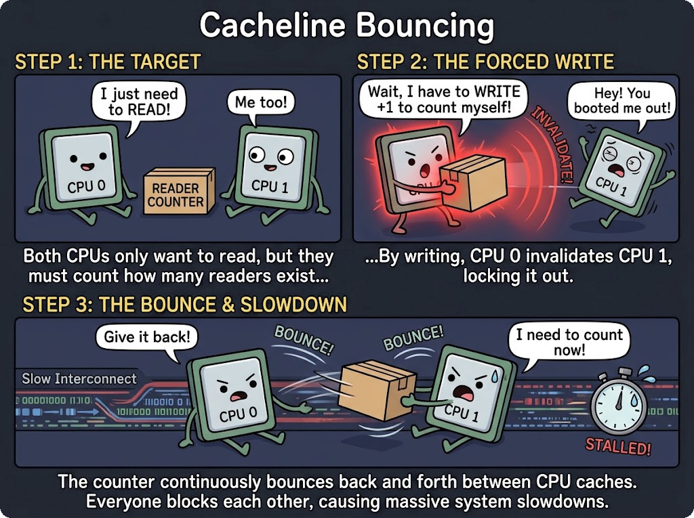

Virtual memory provides every process with the illusion of a vast, private, contiguous address space. In modern software engineering, developers routinely treat pointer dereferences as trivial memory reads or writes handled purely in hardware by the Memory Management Unit (MMU) and Translation Lookaside Buffer (TLB).

However, in multi-threaded, high-throughput systems—such as low-latency market data ticker plants, high-frequency execution engines, in-memory databases, and high-performance runtimes—concurrent memory allocations and accesses can trigger sudden, severe throughput collapse. Profilers show 80% to 95% of CPU time consumed in kernel space (`%sys`), with application worker threads stalled across dozens of CPU cores.

The culprit is almost always **Page Fault overhead coupled with process-wide lock contention**: specifically, Linux's coarse-grained address space reader-writer semaphore, **`mmap_lock`** (formerly known as **`mmap_sem`**).

This post explores the exact mechanics of a page fault in the Linux kernel, analyzes why `mmap_lock` creates a scalability cliff on multi-core architectures, compares page fault costs against direct I/O, and examines modern kernel mitigations such as the Maple Tree and Per-VMA locking.

---

### 1. The Anatomy of a Page Fault

A page fault is not an ordinary software function call; it is a hardware-initiated CPU exception. When an instruction attempts to access a virtual address $V$ whose corresponding entry in the page table is either non-existent or has its Present flag cleared (`Present = 0`), the CPU hardware halts the instruction pipeline and raises `#PF` (Interrupt Vector 14).

<svg viewBox="0 0 760 540" width="100%" style="max-width:760px;display:block;margin:1.5em auto;" role="img" aria-label="Linux Page Fault Resolution Pipeline">
  <defs>
    <marker id="arrow" viewBox="0 0 10 10" refX="6" refY="5" markerWidth="6" markerHeight="6" orient="auto-start-reverse">
      <path d="M 0 1 L 10 5 L 0 9 z" fill="currentColor" fill-opacity="0.6"/>
    </marker>
  </defs>

  <!-- Step 1: Hardware Trap -->
  <rect x="230" y="10" width="300" height="46" rx="6" fill="currentColor" fill-opacity="0.06" stroke="currentColor" stroke-opacity="0.5" stroke-width="1.2"/>
  <text x="380" y="28" text-anchor="middle" font-size="12" font-weight="600" fill="currentColor" fill-opacity="0.95">1. Hardware MMU Exception (#PF)</text>
  <text x="380" y="44" text-anchor="middle" font-size="12.0" fill="currentColor" fill-opacity="0.65">PTE Present = 0 &rarr; Save CR2 &amp; Error Code &rarr; Vector 14</text>

  <line x1="380" y1="56" x2="380" y2="76" stroke="currentColor" stroke-opacity="0.5" stroke-width="1.2" marker-end="url(#arrow)"/>

  <!-- Step 2: Kernel Entry -->
  <rect x="230" y="78" width="300" height="46" rx="6" fill="currentColor" fill-opacity="0.06" stroke="currentColor" stroke-opacity="0.5" stroke-width="1.2"/>
  <text x="380" y="96" text-anchor="middle" font-size="12" font-weight="600" fill="currentColor" fill-opacity="0.95">2. Architecture Entry &amp; Dispatch</text>
  <text x="380" y="112" text-anchor="middle" font-size="12.0" font-family="monospace" fill="currentColor" fill-opacity="0.65">exc_page_fault &rarr; do_user_addr_fault</text>

  <line x1="380" y1="124" x2="380" y2="144" stroke="currentColor" stroke-opacity="0.5" stroke-width="1.2" marker-end="url(#arrow)"/>

  <!-- Step 3: Address Space Lock -->
  <rect x="210" y="146" width="340" height="46" rx="6" fill="currentColor" fill-opacity="0.1" stroke="currentColor" stroke-opacity="0.75" stroke-width="1.4"/>
  <text x="380" y="164" text-anchor="middle" font-size="12" font-weight="700" fill="currentColor" fill-opacity="0.95">3. Acquire Address Space Read Lock</text>
  <text x="380" y="180" text-anchor="middle" font-size="12.0" font-family="monospace" fill="currentColor" fill-opacity="0.75">down_read(&amp;mm-&gt;mmap_lock)  [Contention Point!]</text>

  <line x1="380" y1="192" x2="380" y2="212" stroke="currentColor" stroke-opacity="0.5" stroke-width="1.2" marker-end="url(#arrow)"/>

  <!-- Step 4: VMA Search -->
  <rect x="230" y="214" width="300" height="46" rx="6" fill="currentColor" fill-opacity="0.06" stroke="currentColor" stroke-opacity="0.5" stroke-width="1.2"/>
  <text x="380" y="232" text-anchor="middle" font-size="12" font-weight="600" fill="currentColor" fill-opacity="0.95">4. VMA Lookup &amp; Permission Check</text>
  <text x="380" y="248" text-anchor="middle" font-size="12.0" fill="currentColor" fill-opacity="0.65">Maple Tree (Linux 6.1+) / Red-Black Tree Search</text>

  <!-- Branch: Invalid -> SIGSEGV -->
  <line x1="530" y1="237" x2="610" y2="237" stroke="currentColor" stroke-opacity="0.5" stroke-width="1.2" marker-end="url(#arrow)"/>
  <text x="566" y="230" text-anchor="middle" font-size="12.0" fill="currentColor" fill-opacity="0.6">invalid</text>
  <rect x="612" y="218" width="130" height="38" rx="5" fill="currentColor" fill-opacity="0.04" stroke="currentColor" stroke-opacity="0.4" stroke-width="1"/>
  <text x="677" y="236" text-anchor="middle" font-size="12.0" font-weight="600" fill="currentColor" fill-opacity="0.8">SIGSEGV</text>
  <text x="677" y="248" text-anchor="middle" font-size="12.0" fill="currentColor" fill-opacity="0.5">Segfault to process</text>

  <line x1="380" y1="260" x2="380" y2="280" stroke="currentColor" stroke-opacity="0.5" stroke-width="1.2" marker-end="url(#arrow)"/>
  <text x="395" y="273" text-anchor="start" font-size="12.0" fill="currentColor" fill-opacity="0.6">valid</text>

  <!-- Step 5: Page Table Walk -->
  <rect x="230" y="282" width="300" height="46" rx="6" fill="currentColor" fill-opacity="0.06" stroke="currentColor" stroke-opacity="0.5" stroke-width="1.2"/>
  <text x="380" y="300" text-anchor="middle" font-size="12" font-weight="600" fill="currentColor" fill-opacity="0.95">5. Multi-Level Page Table Walk</text>
  <text x="380" y="316" text-anchor="middle" font-size="12.0" font-family="monospace" fill="currentColor" fill-opacity="0.65">PGD &rarr; P4D &rarr; PUD &rarr; PMD &rarr; PTE</text>

  <!-- Split into 3 cases -->
  <path d="M 380 328 L 380 344 L 130 344 L 130 360" fill="none" stroke="currentColor" stroke-opacity="0.5" stroke-width="1.2" marker-end="url(#arrow)"/>
  <path d="M 380 328 L 380 360" fill="none" stroke="currentColor" stroke-opacity="0.5" stroke-width="1.2" marker-end="url(#arrow)"/>
  <path d="M 380 328 L 380 344 L 630 344 L 630 360" fill="none" stroke="currentColor" stroke-opacity="0.5" stroke-width="1.2" marker-end="url(#arrow)"/>

  <!-- Step 6A: Anonymous -->
  <rect x="20" y="362" width="220" height="54" rx="6" fill="currentColor" fill-opacity="0.06" stroke="currentColor" stroke-opacity="0.5" stroke-width="1.2"/>
  <text x="130" y="380" text-anchor="middle" font-size="12.0" font-weight="600" fill="currentColor" fill-opacity="0.95">Anonymous Page (Minor)</text>
  <text x="130" y="396" text-anchor="middle" font-size="12.0" fill="currentColor" fill-opacity="0.65">Buddy Allocator Frame</text>
  <text x="130" y="408" text-anchor="middle" font-size="12.0" font-family="monospace" fill="currentColor" fill-opacity="0.65">+ CPU memset(0)</text>

  <!-- Step 6B: File-Backed -->
  <rect x="270" y="362" width="220" height="54" rx="6" fill="currentColor" fill-opacity="0.06" stroke="currentColor" stroke-opacity="0.5" stroke-width="1.2"/>
  <text x="380" y="380" text-anchor="middle" font-size="12.0" font-weight="600" fill="currentColor" fill-opacity="0.95">File-Backed Page (Major)</text>
  <text x="380" y="396" text-anchor="middle" font-size="12.0" fill="currentColor" fill-opacity="0.65">Page Cache Miss &rarr; Disk I/O</text>
  <text x="380" y="408" text-anchor="middle" font-size="12.0" fill="currentColor" fill-opacity="0.65">Thread sleeps on wait queue</text>

  <!-- Step 6C: COW -->
  <rect x="520" y="362" width="220" height="54" rx="6" fill="currentColor" fill-opacity="0.06" stroke="currentColor" stroke-opacity="0.5" stroke-width="1.2"/>
  <text x="630" y="380" text-anchor="middle" font-size="12.0" font-weight="600" fill="currentColor" fill-opacity="0.95">Copy-on-Write (COW)</text>
  <text x="630" y="396" text-anchor="middle" font-size="12.0" fill="currentColor" fill-opacity="0.65">Allocate New Page Frame</text>
  <text x="630" y="408" text-anchor="middle" font-size="12.0" font-family="monospace" fill="currentColor" fill-opacity="0.65">+ CPU memcpy(4KB)</text>

  <!-- Converge to Step 7 -->
  <path d="M 130 416 L 130 436 L 380 436" fill="none" stroke="currentColor" stroke-opacity="0.5" stroke-width="1.2"/>
  <path d="M 380 416 L 380 436" fill="none" stroke="currentColor" stroke-opacity="0.5" stroke-width="1.2"/>
  <path d="M 630 416 L 630 436 L 380 436 L 380 448" fill="none" stroke="currentColor" stroke-opacity="0.5" stroke-width="1.2" marker-end="url(#arrow)"/>

  <!-- Step 7: PTE Install & Unlock -->
  <rect x="180" y="450" width="400" height="46" rx="6" fill="currentColor" fill-opacity="0.06" stroke="currentColor" stroke-opacity="0.5" stroke-width="1.2"/>
  <text x="380" y="468" text-anchor="middle" font-size="12" font-weight="600" fill="currentColor" fill-opacity="0.95">6. PTE Install, RMAP &amp; Unlock</text>
  <text x="380" y="484" text-anchor="middle" font-size="12.0" font-family="monospace" fill="currentColor" fill-opacity="0.65">Spinlock PTL &rarr; set_pte_at &rarr; up_read(&amp;mm-&gt;mmap_lock)</text>

  <line x1="380" y1="496" x2="380" y2="512" stroke="currentColor" stroke-opacity="0.5" stroke-width="1.2" marker-end="url(#arrow)"/>

  <!-- Step 8: Return -->
  <rect x="250" y="514" width="260" height="24" rx="4" fill="currentColor" fill-opacity="0.04" stroke="currentColor" stroke-opacity="0.35" stroke-width="1"/>
  <text x="380" y="530" text-anchor="middle" font-size="12.0" fill="currentColor" fill-opacity="0.8">Hardware iret: Resume instruction in user space</text>
</svg>

#### Step 1: Hardware Trap & Architectural Dispatch
1. The CPU hardware saves the process flags, code segment (`CS`), and instruction pointer (`RIP`) onto the kernel interrupt stack.
2. The faulting virtual address is saved into the hardware control register `CR2`.
3. An architecture-specific error code is pushed to the stack (specifying read vs. write, user vs. kernel mode, instruction fetch vs. data access).
4. Control transfers to the kernel entry point: `exc_page_fault()` $\to$ `do_user_addr_fault()` $\to$ `handle_mm_fault()`.

#### Step 2: VMA Lookup & Permission Check
The kernel must determine if the faulting virtual address belongs to a legally mapped region of the process. Every process is described by an `mm_struct`, which contains the list of Virtual Memory Areas (`vm_area_struct` or VMAs).

To safely inspect the VMA collection, the kernel must acquire the process-wide lock:

```c
down_read(&mm->mmap_lock);
```

Once the lock is held, the kernel searches the VMA structure (historically a Red-Black tree `mm->mm_rb`, now a Maple Tree `mm->mm_mt`). If the address does not fall within a valid VMA, or if the access violates permissions (e.g. attempting to write to a read-only VMA), the kernel unlocks and issues a `SIGSEGV` segmentation fault.

#### Step 3: Multi-Level Page Table Walk
On x86-64, the kernel navigates up to 4 or 5 levels of page tables:
$$\text{PGD} \longrightarrow \text{P4D} \longrightarrow \text{PUD} \longrightarrow \text{PMD} \longrightarrow \text{PTE}$$

If intermediate directory entries do not yet exist, the kernel allocates physical pages from the buddy allocator to serve as new page table nodes and zeroes their contents.

#### Step 4: Physical Page Resolution
Depending on the VMA type, the kernel handles the fault in one of three ways:

1. **Anonymous Minor Fault (Heap/Stack Allocation):**
   When `malloc` or `brk` expands virtual memory, no physical RAM is allocated. On the first write, the buddy allocator supplies an empty 4 KB physical page frame. Crucially, **the CPU must explicitly run `memset(0)` on this 4 KB page** to prevent cross-process data leakage.
2. **File-Backed Major Fault (`mmap` on files):**
   When accessing a memory-mapped file whose contents are not in the page cache, the kernel must issue a synchronous read to the underlying storage block device. The calling thread is placed onto a wait queue and put to sleep until the I/O completes.
3. **Copy-on-Write (COW) Fault:**
   Following a `fork()` or when writing to a private mapped region, the PTE is marked read-only. When written to, a new physical frame is allocated, the CPU performs a full 4 KB `memcpy()` from the old shared page to the new page, and the PTE is updated to writable.

#### Step 5: PTE Finalization and Reverse Mapping
The kernel acquires the low-level Page Table Lock (`ptl`), writes the physical address and permission flags into the leaf PTE, hooks the page into the reverse mapping system (`anon_vma`), adds it to the LRU/Folio list for memory reclaim tracking, releases `mmap_lock`, and executes the hardware `iret` instruction to resume the faulting user instruction.

---

### 2. The Bottleneck: Coarse-Grained `mmap_lock`

Why does this become catastrophic in concurrent applications? The fundamental architectural constraint lies in Linux's process address space model:

<svg viewBox="0 0 760 270" width="100%" style="max-width:760px;display:block;margin:1.5em auto;" role="img" aria-label="Shared mm_struct and mmap_lock Contention Across Threads">
  <defs>
    <marker id="arrow2" viewBox="0 0 10 10" refX="6" refY="5" markerWidth="6" markerHeight="6" orient="auto-start-reverse">
      <path d="M 0 1 L 10 5 L 0 9 z" fill="currentColor" fill-opacity="0.6"/>
    </marker>
  </defs>

  <!-- Worker Threads -->
  <rect x="30" y="20" width="160" height="60" rx="6" fill="currentColor" fill-opacity="0.06" stroke="currentColor" stroke-opacity="0.5" stroke-width="1.2"/>
  <text x="110" y="44" text-anchor="middle" font-size="12" font-weight="600" fill="currentColor" fill-opacity="0.95">Thread 1 (Core 0)</text>
  <text x="110" y="62" text-anchor="middle" font-size="12.0" font-family="monospace" fill="currentColor" fill-opacity="0.65">task_struct &rarr; mm</text>

  <rect x="230" y="20" width="160" height="60" rx="6" fill="currentColor" fill-opacity="0.06" stroke="currentColor" stroke-opacity="0.5" stroke-width="1.2"/>
  <text x="310" y="44" text-anchor="middle" font-size="12" font-weight="600" fill="currentColor" fill-opacity="0.95">Thread 2 (Core 1)</text>
  <text x="310" y="62" text-anchor="middle" font-size="12.0" font-family="monospace" fill="currentColor" fill-opacity="0.65">task_struct &rarr; mm</text>

  <text x="440" y="55" text-anchor="middle" font-size="20" fill="currentColor" fill-opacity="0.5">&bull;&bull;&bull;</text>

  <rect x="490" y="20" width="240" height="60" rx="6" fill="currentColor" fill-opacity="0.08" stroke="currentColor" stroke-opacity="0.65" stroke-width="1.2"/>
  <text x="610" y="44" text-anchor="middle" font-size="12" font-weight="600" fill="currentColor" fill-opacity="0.95">Thread N (Allocator / Core 63)</text>
  <text x="610" y="62" text-anchor="middle" font-size="12.0" font-family="monospace" fill="currentColor" fill-opacity="0.65">calls mmap() / munmap()</text>

  <!-- Arrows to shared mm_struct -->
  <line x1="110" y1="80" x2="250" y2="136" stroke="currentColor" stroke-opacity="0.5" stroke-width="1.2" marker-end="url(#arrow2)"/>
  <text x="156" y="116" text-anchor="middle" font-size="12.0" fill="currentColor" fill-opacity="0.6">down_read</text>

  <line x1="310" y1="80" x2="330" y2="136" stroke="currentColor" stroke-opacity="0.5" stroke-width="1.2" marker-end="url(#arrow2)"/>
  <text x="340" y="116" text-anchor="start" font-size="12.0" fill="currentColor" fill-opacity="0.6">down_read</text>

  <line x1="610" y1="80" x2="490" y2="136" stroke="currentColor" stroke-opacity="0.6" stroke-width="1.4" stroke-dasharray="3,3" marker-end="url(#arrow2)"/>
  <text x="580" y="116" text-anchor="middle" font-size="12.0" font-weight="600" fill="currentColor" fill-opacity="0.8">down_write (exclusive!)</text>

  <!-- Process mm_struct Box -->
  <rect x="180" y="140" width="400" height="110" rx="8" fill="currentColor" fill-opacity="0.04" stroke="currentColor" stroke-opacity="0.7" stroke-width="1.4"/>
  <text x="380" y="162" text-anchor="middle" font-size="13" font-weight="700" fill="currentColor" fill-opacity="0.95">Single Shared struct mm_struct (Process Address Space)</text>

  <rect x="200" y="174" width="360" height="34" rx="4" fill="currentColor" fill-opacity="0.08" stroke="currentColor" stroke-opacity="0.4" stroke-width="1"/>
  <text x="380" y="195" text-anchor="middle" font-size="12.0" font-weight="600" fill="currentColor" fill-opacity="0.9">rw_semaphore mmap_lock (Single 64-byte Cacheline)</text>

  <rect x="200" y="214" width="175" height="26" rx="4" fill="currentColor" fill-opacity="0.05" stroke="currentColor" stroke-opacity="0.3" stroke-width="1"/>
  <text x="287" y="231" text-anchor="middle" font-size="12.0" font-family="monospace" fill="currentColor" fill-opacity="0.75">maple_tree mm_mt</text>

  <rect x="385" y="214" width="175" height="26" rx="4" fill="currentColor" fill-opacity="0.05" stroke="currentColor" stroke-opacity="0.3" stroke-width="1"/>
  <text x="472" y="231" text-anchor="middle" font-size="12.0" font-family="monospace" fill="currentColor" fill-opacity="0.75">pgd_t* pgd</text>
</svg>

In Linux, threads are light-weight processes (`task_struct`). All threads within the same process share **the exact same pointer to `mm_struct`**.

To protect the consistency of the VMA tree and page table hierarchy, `mm_struct` embeds a single read-write semaphore:

```c
struct mm_struct {
    struct rw_semaphore mmap_lock; /* Formerly mmap_sem */
    struct maple_tree   mm_mt;     /* VMA storage */
    ...
};
```

This single lock protects **all** virtual memory operations across the entire process.

---

### 3. Four Failure Modes of `mmap_lock` Under High Concurrency

#### Hazard 1: Writer Priority and Process-Wide Stalls

The read-write semaphore distinguishes between readers and writers:
- **Readers (`down_read(&mm->mmap_lock)`):** Invoked on **every single page fault**, `mincore()`, stack auto-growth, and `/proc/[pid]/maps` reads.
- **Writers (`down_write(&mm->mmap_lock)`):** Invoked by any system call that alters the virtual address space layout: `mmap()`, `munmap()`, `mprotect()`, `mremap()`, `brk()`, `madvise(MADV_DONTNEED)`, dynamic library loading via `dlopen()`, and thread creation (allocating thread stacks).

To prevent writer starvation, Linux's `rw_semaphore` implementation gives priority to pending writers.

```
Time ------------------------------------------------------------------------>

Thread 1 (Worker):   [===== Page Fault: down_read =====]
Thread 2 (Allocator):             [ Wants down_write(mmap) -> WAITING ]
Thread 3 (Worker):                           [ Page Fault: down_read -> BLOCKED ]
Thread 4 (Worker):                           [ Page Fault: down_read -> BLOCKED ]
Thread 5..64:                                [ Page Fault: down_read -> BLOCKED ]
```

As soon as Thread 2 requests `down_write`, **all subsequent page faults across all 64 cores are immediately blocked in the kernel wait queue**. If Thread 2 has to perform a slow VMA split, allocate intermediate page structures, or wait for unmapped pages to flush, dozens of high-performance worker threads grinding through market data or computational tasks are frozen simultaneously.

#### Hazard 2: Read-Only Cacheline Bouncing

A common misconception is: *"If our application allocates all memory upfront and never calls `mmap` or `brk` during runtime, we will only have readers, so `mmap_lock` will not contend."*

This is physically false on modern multi-socket NUMA systems.

A read-write semaphore must track how many readers are currently active. In the Linux kernel, this is maintained via atomic operations on a counter field inside the `mmap_lock` structure:

```c
static inline void down_read(struct rw_semaphore *sem) {
    atomic_long_add(RWSEM_READER_BIAS, &sem->count);
}

static inline void up_read(struct rw_semaphore *sem) {
    atomic_long_add(-RWSEM_READER_BIAS, &sem->count);
}
```

The `sem->count` variable resides within a single 64-byte hardware cache line. When 64 CPU cores concurrently trigger page faults across completely different virtual memory addresses:
1. Every core executes an atomic `LOCK ADD` on the exact same memory address (`&sem->count`).
2. The cache coherence protocol (MESI/MOESI) forces the cache line to transition into the **Modified (M)** state on the writing core, invalidating the cache line across all other 63 cores' L1 and L2 caches.
3. The cache line bounces across the interconnect bus (Intel UPI / AMD Infinity Fabric) continuously.

Even with zero writers, **the atomic contention on `sem->count` saturates the CPU interconnect and degrades page fault throughput exponentially as core counts rise**.

<figure style="text-align: center; margin: 2.2em auto; max-width: 580px;">
  <div style="border-radius: 12px; border: 1px solid rgba(255, 255, 255, 0.12); box-shadow: 0 4px 16px rgba(0, 0, 0, 0.25); overflow: hidden; background: #252a34; display: inline-block;">
    
  </div>
</figure>

#### Hazard 3: Split Page Table Lock (PTL) Serialization

Once a thread successfully passes `mmap_lock`, it must install the newly allocated physical page into the leaf Page Table Entry (PTE).

To protect individual page tables, Linux utilizes the **Split Page Table Lock (PTL)**. Instead of one lock for the entire page table hierarchy, each 2 MB region (corresponding to one Page Middle Directory, PMD) shares a spinlock:

```c
spinlock_t *ptl = pte_lockptr(mm, pmd);
spin_lock(ptl);
set_pte_at(mm, address, pte, entry);
spin_unlock(ptl);
```

If multiple worker threads concurrently initialize memory within the same 2 MB virtual window (even if touching distinct 4 KB pages), they serialize on the identical PMD spinlock, burning CPU cycles in kernel busy-wait spin loops.

#### Hazard 4: Inter-Processor Interrupt (IPI) TLB Shootdowns

When mappings are modified, protected (`mprotect`), or unmapped (`munmap`), CPU hardware does not automatically synchronize TLB entries across cores.

The initiating core must issue an **Inter-Processor Interrupt (IPI)** to every CPU core currently executing a thread of that `mm_struct`:
1. The target cores are interrupted from user execution.
2. Their hardware pipelines are flushed.
3. They invalidate their local TLB entries via `invlpg` or CR3 reloads.
4. They acknowledge the IPI.

An application with 64 threads experiencing frequent memory protection changes or unmaps can spend upwards of 30% of aggregate CPU time servicing TLB shootdown IPI interrupts.

---

### 4. Page Faults vs. Direct I/O (`read` with DMA)

A frequent question in system design interviews and performance postmortems:

> *"Memory mapping (`mmap`) avoids data copying between user and kernel buffers. Why can reading a file via `read()` with pre-allocated buffers be vastly faster and more predictable under multi-threaded concurrency than accessing a file via `mmap`?"*

The table below contrasts the low-level execution mechanics:

| Dimension | Direct Sequential `read()` with DMA | On-Demand Access via `mmap()` Page Faults |
| :--- | :--- | :--- |
| **Invocation Pattern** | **Active & Batched:** One system call reads 64 MB into an existing buffer. | **Passive & Fragmented:** Instructions fault on each individual 4 KB boundary. |
| **Exception Overhead** | **1 transition:** 1 user-to-kernel context switch (`syscall`). | **16,384 traps:** 16,384 hardware `#PF` exceptions, interrupt vector jumps, and pipeline flushes for 64 MB. |
| **Data Transfer Engine** | **Hardware DMA Offload:** NIC or disk controller transfers data directly into DRAM. CPU cores remain idle or compute. | **CPU-Bound Operations:** CPU must execute `memset(0)` for anonymous memory or `memcpy()` for COW, saturating memory bandwidth. |
| **Locking Scope** | **Localized:** Locks the file descriptor and page cache folio; never touches process VMAs. | **Global (`mmap_lock`):** Requires `down_read(&mm->mmap_lock)` 16,384 times, serializing against any address space writer. |
| **Cache Impact** | **Streaming friendly:** Can bypass CPU caches entirely using Direct I/O (`O_DIRECT`). | **Cache polluting:** Memory initialization actively evicts L1/L2/L3 working sets. |

For a 64 MB region, the calculation is stark:
$$\frac{64 \times 1024 \times 1024\text{ bytes}}{4096\text{ bytes/page}} = \mathbf{16,384\text{ page faults}}$$

Under `read()`, 64 MB is fetched in a handful of batched DMA transactions with minimal CPU involvement. Under lazy `mmap()`, the CPU must trap 16,384 times, contend for `mmap_lock` 16,384 times, walk page tables 16,384 times, and update TLBs 16,384 times.

---

### 5. Modern Kernel Evolutions: Maple Tree & Per-VMA Locks

The Linux kernel community has spent years engineering solutions to eliminate `mmap_lock` contention. Two major milestones represent the modern state of the art:

#### 1. The Maple Tree (Linux 6.1+)
Historically, a process's VMAs were stored in an augmented Red-Black tree (`mm->mm_rb`). While search was $O(\log N)$, balancing and traversal required strict mutual exclusion under `mmap_lock`.

In Linux 6.1, Liam Howlett and Matthew Wilcox introduced the **Maple Tree** (`struct maple_tree`):
- A B-tree variant optimized for storing non-overlapping ranges (virtual address intervals).
- Each node stores multiple ranges per 64-byte or 256-byte cache line, significantly improving cache locality over pointer-heavy red-black nodes.
- **RCU-Safe:** Allows lockless concurrent lookups via Read-Copy-Update (RCU), providing the foundation for lockless VMA searches without acquiring writer locks.

#### 2. Per-VMA Locks (Linux 6.4+)
Pioneered by Suren Baghdasaryan and Laurent Dufour, Linux 6.4 introduced **Per-VMA Locking** for anonymous page fault handling.

Instead of acquiring the process-global `down_read(&mm->mmap_lock)`, the page fault handler attempts speculative resolution:

```c
/* Simplified conceptual view of per-VMA page faulting */
struct vm_area_struct *vma = lock_vma_under_rcu(mm, address);
if (vma) {
    /* Handled entirely under vma->vm_lock without touching mm->mmap_lock! */
    handle_pte_fault(&vmf);
    vma_read_unlock(vma);
    return;
}

/* Fallback to global mmap_lock if VMA is being modified */
down_read(&mm->mmap_lock);
...
```

1. The kernel looks up the target VMA using RCU on the Maple Tree (zero write operations on shared memory).
2. It acquires a reader lock on the **specific VMA's local lock** (`vma->vm_lock`).
3. If successful, the page fault completes without ever touching `mm->mmap_lock`.

**Result:** Threads faulting on different memory regions (e.g. Thread A working in Arena 1 and Thread B working in Arena 2) run in true hardware parallelism with zero cacheline bouncing on `mmap_lock`.

---

### 6. Application-Level Engineering Best Practices

While newer Linux kernels mitigate contention, production systems operating on enterprise kernels (RHEL 8/9, LTS kernels) or demanding deterministic sub-microsecond latency must architect around page faults in user space.

#### Strategy 1: Pre-Faulting at Allocation (`MAP_POPULATE`)
When allocating memory buffers, instruct the kernel to immediately allocate physical frames and populate page tables during the initial call:

```c
void* ptr = mmap(NULL, size, PROT_READ | PROT_WRITE,
                 MAP_PRIVATE | MAP_ANONYMOUS | MAP_POPULATE, -1, 0);
```

`MAP_POPULATE` performs all page table walks, allocations, and zeroing upfront during application startup or warm-up. The hot execution loop encounters pre-established PTEs and incurs **zero page faults**.

#### Strategy 2: Transparent & Explicit Huge Pages (THP / HugeTLB)
Using standard 4 KB pages requires 262,144 page faults per gigabyte of memory. Switching to 2 MB Huge Pages reduces this by a factor of 512:

$$\frac{1\text{ GB}}{2\text{ MB}} = 512\text{ page faults (vs. } 262,144\text{)}$$

```c
/* Advise the kernel to back this mapping with 2MB huge pages */
madvise(ptr, size, MADV_HUGEPAGE);
```

Beyond slashing page fault frequency by $99.8\%$, huge pages eliminate intermediate PUD/PMD walk steps and drastically reduce TLB misses.

#### Strategy 3: Arena-Based Memory Allocators
Default `malloc` implementations (`glibc ptmalloc`) can trigger `brk` or `mmap` under heap fragmentation, invoking `down_write(&mm->mmap_lock)` and stalling all threads.

High-throughput engines deploy arena-centric allocators such as **jemalloc** or **mimalloc**:
- Pre-reserve large virtual memory arenas per CPU core or thread group.
- Keep allocations within pre-mapped memory chunks, completely avoiding runtime `mmap` or `munmap` system calls during trading hours or active request cycles.

#### Strategy 4: Diagnostic Profiling Commands
To diagnose whether `mmap_lock` is stalling your production services:

```bash
# 1. Inspect minor vs major page faults for a running process
/usr/bin/time -v ./trading_engine

# 2. Record live page faults system-wide
perf record -e page-faults -g -p <PID> -- sleep 10
perf report --stdio

# 3. Trace kernel time spent waiting on mmap_lock (requires bpftrace)
bpftrace -e '
kprobe:down_read /comm == "trading_engine"/ { @start[tid] = nsecs; }
kretprobe:down_read /@start[tid]/ {
    @latency_us = hist((nsecs - @start[tid]) / 1000);
    delete(@start[tid]);
}'
```

---

### Summary

The Linux `mmap_lock` bottleneck demonstrates how low-level OS abstractions leak into application performance:

1. **Every page fault is an OS exception:** It requires hardware context shifts, VMA traversal, page table allocations, physical memory zeroing, and TLB management.
2. **`mmap_lock` is process-global:** Any address-space mutating system call (`mmap`, `munmap`, `mprotect`, `brk`) acquires the lock as a writer, instantly blocking concurrent page faults across all threads in the process.
3. **Atomic reads bounce cache lines:** Even in read-only workloads, dozens of cores executing atomic operations on `sem->count` exhaust CPU cache-coherency bus bandwidth.
4. **Mitigation is architectural:** Modern kernels provide relief via Maple Trees and Per-VMA locks, but mission-critical systems should always pre-fault (`MAP_POPULATE`), leverage huge pages (2 MB / 1 GB), and use pre-warmed memory arenas to eliminate page faults from the critical path entirely.
