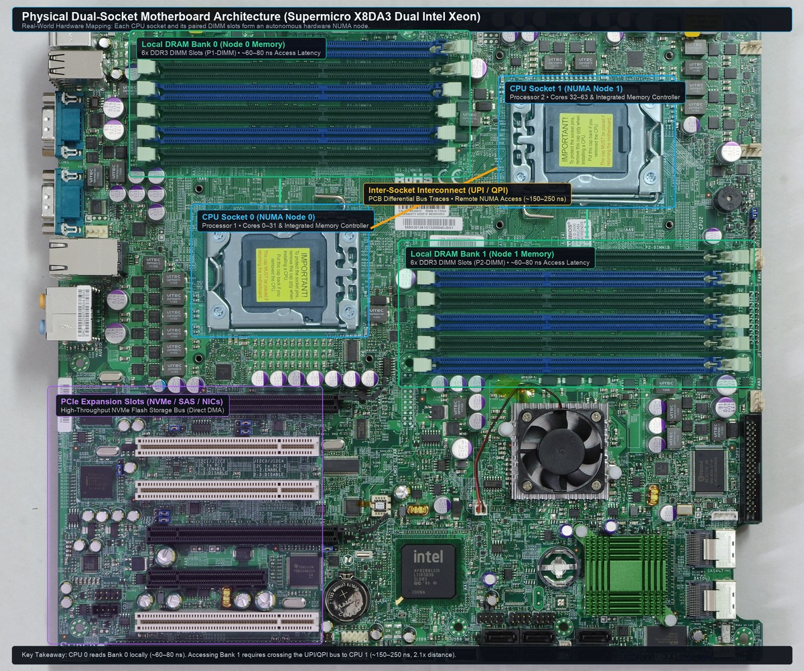

In high-throughput, data-intensive systems—such as quantitative backtesting platforms, time-series databases (e.g., ClickHouse, InfluxDB), storage engines (RocksDB), and analytical log scanners—memory workloads often exhibit a dual personality:

1. **Large-scale Sequential Streaming:** A backtest worker or bulk ETL scanner ingests multi-gigabyte or terabyte tick datasets sequentially from NVMe storage at 2–5 GB/s. Each data page is examined once and never accessed again.
2. **Latency-Critical Random Access:** Concurrent execution threads perform point lookups against hot reference tables, recent order book states, or active account risk caches requiring deterministic microsecond latencies.

On a production server with 64 GB to 256 GB of physical RAM, these two workloads share the exact same operating system **Page Cache**. 

When bulk streaming fills physical RAM, the operating system triggers memory reclamation. Instead of gracefully discarding only the single-use streaming pages, the system frequently suffers from **Page Cache Thrashing and Direct Reclaim Storms**: throughput plummets, CPU usage spikes to 90%+ in kernel space (`%sys`), and random point queries that previously completed in sub-microseconds freeze for tens or hundreds of milliseconds.

This post examines how Linux decides which pages to evict, the mechanics of zone watermarks and the dual-LRU list architecture, why sequential scans relentlessly wash away hot random-access working sets, and how production systems architect around this bottleneck.

---

### 1. Physical Memory Topography: NUMA Nodes and Memory Zones

Before analyzing memory watermarks and page eviction, we must understand how the Linux kernel perceives physical RAM. The operating system does not treat installed memory as a single, uniform pool. Instead, physical memory is organized into a two-level hierarchy: **NUMA Nodes** at the hardware level, subdivided into **Memory Zones** at the architectural level.

<svg viewBox="0 0 880 430" width="100%" style="max-width:880px;display:block;margin:2em auto;" role="img" aria-label="NUMA Nodes and Memory Zone Hierarchy in Linux">
  <defs>
    <marker id="numa-arrow" viewBox="0 0 10 10" refX="6" refY="5" markerWidth="6" markerHeight="6" orient="auto-start-reverse">
      <path d="M 0 1 L 10 5 L 0 9 z" fill="currentColor" fill-opacity="0.6"/>
    </marker>
  </defs>

  <!-- NUMA Node 0 Container -->
  <rect x="20" y="15" width="395" height="395" rx="8" fill="currentColor" fill-opacity="0.04" stroke="currentColor" stroke-opacity="0.4" stroke-width="1.4"/>
  <text x="217" y="44" text-anchor="middle" font-size="15" font-weight="700" fill="currentColor" fill-opacity="0.95">NUMA Node 0 (Socket 0)</text>

  <!-- Node 0: Cores & Memory Controller -->
  <rect x="38" y="60" width="170" height="54" rx="5" fill="#38bdf8" fill-opacity="0.08" stroke="#0284c7" stroke-opacity="0.4" stroke-width="1"/>
  <text x="123" y="83" text-anchor="middle" font-size="13" font-weight="600" fill="#38bdf8">CPU Cores 0–31</text>
  <text x="123" y="101" text-anchor="middle" font-size="11.5" fill="currentColor" fill-opacity="0.7">Memory Controller (IMC)</text>

  <!-- Node 0: Local DRAM -->
  <rect x="230" y="60" width="170" height="54" rx="5" fill="#10b981" fill-opacity="0.08" stroke="#10b981" stroke-opacity="0.4" stroke-width="1"/>
  <text x="315" y="83" text-anchor="middle" font-size="13" font-weight="600" fill="#10b981">Local DRAM (64 GB)</text>
  <text x="315" y="101" text-anchor="middle" font-size="11.5" fill="currentColor" fill-opacity="0.7">~60–80 ns Access Latency</text>

  <line x1="208" y1="87" x2="228" y2="87" stroke="#10b981" stroke-width="1.6" marker-end="url(#numa-arrow)"/>

  <!-- Inside Node 0: Memory Zones Breakdown -->
  <rect x="38" y="130" width="362" height="260" rx="6" fill="currentColor" fill-opacity="0.03" stroke="currentColor" stroke-opacity="0.25" stroke-width="1"/>
  <text x="219" y="156" text-anchor="middle" font-size="14" font-weight="700" fill="currentColor" fill-opacity="0.85">Memory Zones (Node 0)</text>

  <!-- ZONE_DMA32 -->
  <rect x="52" y="170" width="334" height="52" rx="4" fill="currentColor" fill-opacity="0.04" stroke="currentColor" stroke-opacity="0.3" stroke-width="1"/>
  <text x="68" y="192" font-size="13" font-weight="700" fill="currentColor" fill-opacity="0.9">ZONE_DMA32 (0 – 4 GB)</text>
  <text x="68" y="210" font-size="11.5" fill="currentColor" fill-opacity="0.6">Legacy 32-bit DMA addressable range</text>

  <!-- ZONE_NORMAL -->
  <rect x="52" y="234" width="334" height="142" rx="4" fill="#38bdf8" fill-opacity="0.08" stroke="#0284c7" stroke-opacity="0.5" stroke-width="1.2"/>
  <text x="68" y="259" font-size="13.5" font-weight="700" fill="#38bdf8">ZONE_NORMAL (4 GB – 64 GB)</text>
  <text x="68" y="283" font-size="12" fill="currentColor" fill-opacity="0.75">Hosts Page Cache, user heap &amp; stacks</text>
  <text x="68" y="309" font-size="12" font-weight="600" fill="#f59e0b">&bull; Has private Watermarks (Min, Low, High)</text>
  <text x="68" y="333" font-size="12" font-weight="600" fill="#f59e0b">&bull; Independent Active / Inactive LRU Lists</text>
  <text x="68" y="357" font-size="12" font-weight="600" fill="#10b981">&bull; Reclaimed by dedicated kswapd0 worker</text>

  <!-- Interconnect in Middle -->
  <line x1="415" y1="87" x2="465" y2="87" stroke="#f59e0b" stroke-width="2.5" stroke-dasharray="3,2"/>
  <rect x="420" y="145" width="40" height="90" rx="5" fill="#0b0f16" stroke="#f59e0b" stroke-width="1.2"/>
  <text x="440" y="180" text-anchor="middle" font-size="11" font-weight="700" fill="#f59e0b">UPI / IF</text>
  <text x="440" y="202" text-anchor="middle" font-size="10" fill="currentColor" fill-opacity="0.7">~250ns</text>

  <!-- NUMA Node 1 Container -->
  <rect x="465" y="15" width="395" height="395" rx="8" fill="currentColor" fill-opacity="0.04" stroke="currentColor" stroke-opacity="0.4" stroke-width="1.4"/>
  <text x="662" y="44" text-anchor="middle" font-size="15" font-weight="700" fill="currentColor" fill-opacity="0.95">NUMA Node 1 (Socket 1)</text>

  <!-- Node 1: Cores & Memory Controller -->
  <rect x="483" y="60" width="170" height="54" rx="5" fill="#38bdf8" fill-opacity="0.08" stroke="#0284c7" stroke-opacity="0.4" stroke-width="1"/>
  <text x="568" y="83" text-anchor="middle" font-size="13" font-weight="600" fill="#38bdf8">CPU Cores 32–63</text>
  <text x="568" y="101" text-anchor="middle" font-size="11.5" fill="currentColor" fill-opacity="0.7">Memory Controller (IMC)</text>

  <!-- Node 1: Local DRAM -->
  <rect x="675" y="60" width="170" height="54" rx="5" fill="#10b981" fill-opacity="0.08" stroke="#10b981" stroke-opacity="0.4" stroke-width="1"/>
  <text x="760" y="83" text-anchor="middle" font-size="13" font-weight="600" fill="#10b981">Local DRAM (64 GB)</text>
  <text x="760" y="101" text-anchor="middle" font-size="11.5" fill="currentColor" fill-opacity="0.7">~60–80 ns Access Latency</text>

  <line x1="653" y1="87" x2="673" y2="87" stroke="#10b981" stroke-width="1.6" marker-end="url(#numa-arrow)"/>

  <!-- Inside Node 1: Memory Zones Breakdown -->
  <rect x="483" y="130" width="362" height="260" rx="6" fill="currentColor" fill-opacity="0.03" stroke="currentColor" stroke-opacity="0.25" stroke-width="1"/>
  <text x="664" y="156" text-anchor="middle" font-size="14" font-weight="700" fill="currentColor" fill-opacity="0.85">Memory Zones (Node 1)</text>

  <!-- ZONE_DMA32 -->
  <rect x="497" y="170" width="334" height="52" rx="4" fill="currentColor" fill-opacity="0.04" stroke="currentColor" stroke-opacity="0.3" stroke-width="1"/>
  <text x="513" y="192" font-size="13" font-weight="700" fill="currentColor" fill-opacity="0.9">ZONE_DMA32 (0 – 4 GB)</text>
  <text x="513" y="210" font-size="11.5" fill="currentColor" fill-opacity="0.6">Present if node spans lower 4 GB</text>

  <!-- ZONE_NORMAL -->
  <rect x="497" y="234" width="334" height="142" rx="4" fill="#38bdf8" fill-opacity="0.08" stroke="#0284c7" stroke-opacity="0.5" stroke-width="1.2"/>
  <text x="513" y="259" font-size="13.5" font-weight="700" fill="#38bdf8">ZONE_NORMAL (4 GB – 64 GB)</text>
  <text x="513" y="283" font-size="12" fill="currentColor" fill-opacity="0.75">Hosts Page Cache, user heap &amp; stacks</text>
  <text x="513" y="309" font-size="12" font-weight="600" fill="#f59e0b">&bull; Has private Watermarks (Min, Low, High)</text>
  <text x="513" y="333" font-size="12" font-weight="600" fill="#f59e0b">&bull; Independent Active / Inactive LRU Lists</text>
  <text x="513" y="357" font-size="12" font-weight="600" fill="#10b981">&bull; Reclaimed by dedicated kswapd1 worker</text>
</svg>

<p align="center">
  
</p>

#### What is a NUMA Node?
In traditional architectures (Uniform Memory Access, or UMA), all CPU cores connect to a single shared memory bus. Every core accesses any byte of physical RAM with identical latency.

As servers scaled to 32, 64, or 128+ cores, that single shared memory bus became a severe throughput bottleneck. Modern multi-socket and multi-chiplet servers (e.g. Intel Xeon, AMD EPYC) adopt **Non-Uniform Memory Access (NUMA)**:
- Physical RAM is physically divided and wired directly to the integrated memory controller (IMC) of specific CPU sockets.
- A **NUMA Node** represents an autonomous hardware unit: a set of CPU cores, their memory controller, and their directly attached physical DRAM channels.
- **Latency Disparity:**
  - **Local Memory Access:** When Core 0 reads memory on its own NUMA Node 0, the electrical path is short, completing in **~60–80 ns**.
  - **Remote Memory Access:** When Core 0 reads memory wired to NUMA Node 1, requests must cross inter-socket bus links (Intel UPI or AMD Infinity Fabric), elevating access latency to **~150–300+ ns**.

#### What is a Memory Zone (`struct zone`)?
Within each NUMA node, physical memory addresses are partitioned into **Memory Zones** based on hardware addressing limits and peripheral bus architectures:

1. **`ZONE_DMA` (First 16 MB of physical RAM):**
   Reserved for historical hardware peripherals (such as legacy 24-bit ISA bus devices) that cannot address memory above 16 MB ($2^{24}$ bytes).
2. **`ZONE_DMA32` (Physical RAM from 0 to 4 GB):**
   On 64-bit platforms, many PCI peripherals are constrained to 32-bit DMA addressing and cannot access physical memory above 4 GB ($2^{32}$ bytes). This zone ensures that buffers allocated for these devices remain physically addressable.
3. **`ZONE_NORMAL` (4 GB up to Total System RAM):**
   The primary workhorse of modern servers. This zone contains the vast majority of physical RAM and hosts general user-space memory (heaps, stacks, anonymous memory) and the **OS Page Cache**.
4. **`ZONE_MOVABLE`:**
   A pseudo-zone containing pages that can be dynamically relocated in physical memory, used to prevent physical memory fragmentation and support memory hot-unplugging.

---

### 2. Zone Watermarks: From Asynchronous `kswapd` to Synchronous Freezes

Inside each memory zone, the kernel tracks free memory against three fundamental **watermarks**:

<svg viewBox="0 0 880 490" width="100%" style="max-width:880px;display:block;margin:2em auto;" role="img" aria-label="Linux Memory Zone Watermarks and Reclaim States">
  <defs>
    <marker id="arrow-green" viewBox="0 0 10 10" refX="6" refY="5" markerWidth="6" markerHeight="6" orient="auto-start-reverse">
      <path d="M 0 1 L 10 5 L 0 9 z" fill="#10b981"/>
    </marker>
    <marker id="arrow-orange" viewBox="0 0 10 10" refX="6" refY="5" markerWidth="6" markerHeight="6" orient="auto-start-reverse">
      <path d="M 0 1 L 10 5 L 0 9 z" fill="#f59e0b"/>
    </marker>
    <marker id="arrow-red" viewBox="0 0 10 10" refX="6" refY="5" markerWidth="6" markerHeight="6" orient="auto-start-reverse">
      <path d="M 0 1 L 10 5 L 0 9 z" fill="#ef4444"/>
    </marker>
  </defs>

  <!-- Physical Memory Container (Left: width 246px) -->
  <rect x="20" y="25" width="246" height="445" rx="8" fill="currentColor" fill-opacity="0.04" stroke="currentColor" stroke-opacity="0.4" stroke-width="1.4"/>
  <text x="143" y="48" text-anchor="middle" font-size="15" font-weight="700" fill="currentColor" fill-opacity="0.95">Memory Zone (Free RAM)</text>

  <!-- Above WMARK_HIGH: Plenty of RAM -->
  <rect x="30" y="60" width="226" height="84" rx="4" fill="#10b981" fill-opacity="0.12" stroke="#10b981" stroke-opacity="0.5" stroke-width="1"/>
  <text x="143" y="88" text-anchor="middle" font-size="13.5" font-weight="600" fill="#10b981">Zone Calm (Ample Free RAM)</text>
  <text x="143" y="110" text-anchor="middle" font-size="11.5" fill="currentColor" fill-opacity="0.7">Allocations succeed instantly</text>
  <text x="143" y="128" text-anchor="middle" font-size="11" fill="currentColor" fill-opacity="0.55">(~0 ns overhead)</text>

  <!-- WMARK_HIGH Line & Badge -->
  <line x1="20" y1="149" x2="268" y2="149" stroke="#10b981" stroke-width="2" stroke-dasharray="4,3"/>
  <rect x="270" y="137" width="98" height="24" rx="4" fill="#064e3b" fill-opacity="0.3" stroke="#10b981" stroke-width="1"/>
  <text x="319" y="153" text-anchor="middle" font-size="11.5" font-weight="700" fill="#10b981">WMARK_HIGH</text>

  <!-- Between HIGH and LOW: kswapd recovery band -->
  <rect x="30" y="155" width="226" height="68" rx="4" fill="#38bdf8" fill-opacity="0.08" stroke="#0284c7" stroke-opacity="0.3" stroke-width="1"/>
  <text x="143" y="184" text-anchor="middle" font-size="13" font-weight="600" fill="#38bdf8">kswapd Recovery Band</text>
  <text x="143" y="205" text-anchor="middle" font-size="11" fill="currentColor" fill-opacity="0.65">Reclaims until RAM &gt; WMARK_HIGH</text>

  <!-- WMARK_LOW Line & Badge -->
  <line x1="20" y1="228" x2="268" y2="228" stroke="#f59e0b" stroke-width="2" stroke-dasharray="4,3"/>
  <rect x="270" y="216" width="98" height="24" rx="4" fill="#451a03" fill-opacity="0.3" stroke="#f59e0b" stroke-width="1"/>
  <text x="319" y="232" text-anchor="middle" font-size="11.5" font-weight="700" fill="#f59e0b">WMARK_LOW</text>

  <!-- Between LOW and MIN: kswapd active trigger zone -->
  <rect x="30" y="234" width="226" height="96" rx="4" fill="#f59e0b" fill-opacity="0.12" stroke="#f59e0b" stroke-opacity="0.4" stroke-width="1"/>
  <text x="143" y="266" text-anchor="middle" font-size="13.5" font-weight="600" fill="#f59e0b">Background Reclaim</text>
  <text x="143" y="288" text-anchor="middle" font-size="11.5" fill="currentColor" fill-opacity="0.7">kswapd scans &amp; reclaims</text>
  <text x="143" y="306" text-anchor="middle" font-size="11" fill="currentColor" fill-opacity="0.55">in background (async)</text>

  <!-- WMARK_MIN Line & Badge -->
  <line x1="20" y1="336" x2="268" y2="336" stroke="#ef4444" stroke-width="2.2"/>
  <rect x="270" y="324" width="98" height="24" rx="4" fill="#450a0a" fill-opacity="0.4" stroke="#ef4444" stroke-width="1"/>
  <text x="319" y="340" text-anchor="middle" font-size="11.5" font-weight="700" fill="#ef4444">WMARK_MIN</text>

  <!-- Below WMARK_MIN: Direct Reclaim -->
  <rect x="30" y="342" width="226" height="118" rx="4" fill="#ef4444" fill-opacity="0.22" stroke="#ef4444" stroke-opacity="0.7" stroke-width="1.2"/>
  <text x="143" y="380" text-anchor="middle" font-size="12" font-weight="700" fill="#f87171">DIRECT RECLAIM CRITICAL</text>
  <text x="143" y="406" text-anchor="middle" font-size="11" fill="currentColor" fill-opacity="0.75">Allocating threads blocked</text>
  <text x="143" y="426" text-anchor="middle" font-size="11" font-weight="600" fill="#fca5a5">Latency spikes to 50–200+ ms</text>

  <!-- Narrative Action Cards (Right: x=415 to x=860, width=445) -->

  <!-- Card 0: Normal Path (Green) -->
  <rect x="415" y="55" width="445" height="92" rx="6" fill="#064e3b" fill-opacity="0.12" stroke="#10b981" stroke-opacity="0.5" stroke-width="1.2"/>
  <text x="435" y="82" font-size="14.5" font-weight="700" fill="#10b981">Ample Memory: Fast Path Allocation</text>
  <text x="435" y="106" font-size="12.5" fill="currentColor" fill-opacity="0.85">&bull; Free RAM is comfortably above WMARK_LOW</text>
  <text x="435" y="128" font-size="12.5" font-weight="600" fill="#10b981">&check; Buddy allocator fulfills requests instantly (~50 ns)</text>
  <!-- Arrow 0: from Green zone (y=101) to Card 0 -->
  <line x1="370" y1="101" x2="408" y2="101" stroke="#10b981" stroke-width="1.6" marker-end="url(#arrow-green)"/>

  <!-- Card 1: Level 1 kswapd (Orange) - Horizontally aligned with Background Reclaim (y=234..330) -->
  <rect x="415" y="215" width="445" height="122" rx="6" fill="#451a03" fill-opacity="0.2" stroke="#f59e0b" stroke-opacity="0.6" stroke-width="1.3"/>
  <text x="435" y="242" font-size="14.5" font-weight="700" fill="#f59e0b">Level 1: Asynchronous kswapd Daemon</text>
  <text x="435" y="267" font-size="12.5" fill="currentColor" fill-opacity="0.9">&bull; Triggered when free memory drops below WMARK_LOW</text>
  <text x="435" y="291" font-size="12.5" fill="currentColor" fill-opacity="0.75">&bull; Dedicated kernel worker scans LRUs to evict clean pages</text>
  <text x="435" y="315" font-size="12.5" font-weight="600" fill="#10b981">&check; Application worker threads are NOT blocked</text>
  <!-- Arrow 1: from Orange Background Reclaim zone (y=280) directly to Card 1 -->
  <line x1="370" y1="280" x2="408" y2="280" stroke="#f59e0b" stroke-width="1.6" marker-end="url(#arrow-orange)"/>

  <!-- Card 2: Level 2 Direct Reclaim (Red) - Horizontally aligned with DIRECT RECLAIM CRITICAL (y=342..460) -->
  <rect x="415" y="355" width="445" height="115" rx="6" fill="#450a0a" fill-opacity="0.3" stroke="#ef4444" stroke-opacity="0.7" stroke-width="1.4"/>
  <text x="435" y="380" font-size="14.5" font-weight="700" fill="#f87171">Level 2: Synchronous Direct Reclaim</text>
  <text x="435" y="404" font-size="12.5" fill="currentColor" fill-opacity="0.9">&bull; Ingestion rate outpaces kswapd &middot; RAM drops below WMARK_MIN</text>
  <text x="435" y="426" font-size="12.5" font-weight="700" fill="#ef4444">&times; CALLING THREADS ARE SYNCHRONOUSLY BLOCKED!</text>
  <text x="435" y="448" font-size="12.5" font-weight="600" fill="#fbbf24">&bull; Allocation latency spikes from ~50ns to 50–200+ ms</text>
  <!-- Arrow 2: from Red Direct Reclaim zone (y=405) directly to Card 2 -->
  <line x1="370" y1="405" x2="408" y2="405" stroke="#ef4444" stroke-width="1.6" marker-end="url(#arrow-red)"/>
</svg>

#### The Reclaim States

1. **Ample Memory (`Free > WMARK_HIGH`):**
   The system operates smoothly. The kernel fulfills page allocations immediately from the buddy allocator's free lists without reclaiming existing pages.
2. **Background Reclamation (`Free < WMARK_LOW`):**
   When physical memory drops below `WMARK_LOW`, the kernel wakes up the per-NUMA background daemon, **`kswapd`**. 
   - `kswapd` asynchronously scans page lists, evicting clean file pages and writing back dirty pages until free memory returns to `WMARK_HIGH`.
   - **Crucially:** Application threads do not pause; they continue allocating memory concurrently while `kswapd` does the janitorial work in the background.
3. **Emergency Direct Reclaim (`Free < WMARK_MIN`):**
   When high-speed sequential ingestion (e.g. streaming tick files at 3 GB/s from PCIe 4.0 NVMe drives) allocates memory faster than `kswapd` can free it, free memory crashes below `WMARK_MIN`.
   - **The Execution Trap:** The kernel invokes **Direct Reclaim** (`try_to_free_pages`). The thread attempting to allocate memory is **synchronously stopped**.
   - It is stripped of its user-mode execution context and forced to traverse the kernel's LRU page lists, contend on memory zone spinlocks, flush dirty buffers to disk, and invalidate page tables.
   - **Latency Explosion:** Operations that normally take 50 nanoseconds suddenly stall for **50 to 200+ milliseconds**, freezing latency-sensitive algorithms.

---

### 3. The Dual-LRU Architecture: Active and Inactive Lists

To decide *which* specific pages to evict, Linux does not use a simplistic single LRU (Least Recently Used) queue. Why? Because a single LRU queue has a fatal design flaw: **Cache Scrubbing (The Scan Resistance Problem)**.

#### Why a Single LRU Fails: The "One-Hit Wonder" Disaster

Imagine an HFT trading host with 64 GB of physical RAM:

1. **The Valuable Working Set:** Your execution engine maintains a **20 GB hot working set** in memory—active order-book depth, price ladders, and symbol state tables. These pages are referenced hundreds of thousands of times every second.
2. **The Sequential Scan:** A background analytics worker or compliance script executes a one-off sequential search across a **50 GB historical tick log**:
   ```bash
   grep "MARGIN_CALL" /data/ticks/2026-11-05_raw_ticks.log
   ```
3. **The Single LRU Collapse:**
   - Under a naive single LRU queue, *every newly accessed page is immediately placed at the **HEAD*** as "Most Recently Used".
   - Every single page of the 50 GB log file is read **exactly once and will never be touched again** (a *"one-hit wonder"*). Yet, because it was read *just a few microseconds ago*, the kernel treats it as more important than your order-book pages.
   - As the 50 GB sequential stream rushes through the page cache, it relentlessly pushes the entire queue forward.
   - Your hot 20 GB order book—despite having been accessed millions of times over the past hour—is pushed to the **TAIL** and **flushed entirely out of RAM** to make room for throwaway log bytes!
   - The next live market tick arrives, trips a catastrophic **Major Page Fault**, and freezes your trading strategy for 50–100+ ms while the kernel re-reads the order-book pages back from NVMe storage.

To prevent single-pass scans from destroying the operating working set, Linux splits page tracking into two lists governed by a **Two-Touch Policy**:

<svg viewBox="0 0 880 440" width="100%" style="max-width:880px;display:block;margin:2em auto;" role="img" aria-label="Linux Dual LRU Active and Inactive List State Transitions">
  <defs>
    <marker id="lru-arrow-gray" viewBox="0 0 10 10" refX="6" refY="5" markerWidth="6" markerHeight="6" orient="auto-start-reverse">
      <path d="M 0 1 L 10 5 L 0 9 z" fill="currentColor" fill-opacity="0.5"/>
    </marker>
    <marker id="lru-arrow-green" viewBox="0 0 10 10" refX="6" refY="5" markerWidth="6" markerHeight="6" orient="auto-start-reverse">
      <path d="M 0 1 L 10 5 L 0 9 z" fill="#10b981"/>
    </marker>
    <marker id="lru-arrow-orange" viewBox="0 0 10 10" refX="6" refY="5" markerWidth="6" markerHeight="6" orient="auto-start-reverse">
      <path d="M 0 1 L 10 5 L 0 9 z" fill="#f59e0b"/>
    </marker>
    <marker id="lru-arrow-red" viewBox="0 0 10 10" refX="6" refY="5" markerWidth="6" markerHeight="6" orient="auto-start-reverse">
      <path d="M 0 1 L 10 5 L 0 9 z" fill="#ef4444"/>
    </marker>
  </defs>

  <!-- Top Demotion Flow: Truly segmented arrows entering & leaving Demotion Card with ZERO overlap -->
  <!-- Segment 1: from Active TAIL (x=770) up into right side of Demotion Card (45px clear of Active List title) -->
  <path d="M 770 132 V 40 H 602" fill="none" stroke="#f59e0b" stroke-width="1.8" stroke-dasharray="5,4" marker-end="url(#lru-arrow-orange)"/>
  
  <!-- Demotion Card (Sitting in clear open gap between x=280 and x=595; no line passes through it) -->
  <rect x="280" y="26" width="315" height="28" rx="5" fill="#451a03" stroke="#f59e0b" stroke-opacity="0.8" stroke-width="1.2"/>
  <text x="437" y="44" text-anchor="middle" font-size="11.5" font-weight="600" fill="#f59e0b">Demotion: Inactive deficit &middot; unreferenced page</text>
  
  <!-- Segment 2: from left side of Demotion Card down into Inactive HEAD at x=100 (52px clear of Inactive List title) -->
  <path d="M 274 40 H 100 V 126" fill="none" stroke="#f59e0b" stroke-width="1.8" stroke-dasharray="5,4" marker-end="url(#lru-arrow-orange)"/>

  <!-- Inactive List Container (Left) -->
  <rect x="25" y="70" width="400" height="275" rx="8" fill="currentColor" fill-opacity="0.04" stroke="currentColor" stroke-opacity="0.35" stroke-width="1.2"/>
  <!-- Container Header (Centered in open gap x=152..298, maintaining 52px of clear air to the vertical line at x=100) -->
  <text x="225" y="96" text-anchor="middle" font-size="14.5" font-weight="700" fill="currentColor" fill-opacity="0.95">Inactive List</text>
  <text x="225" y="114" text-anchor="middle" font-size="11.5" fill="currentColor" fill-opacity="0.6">Probationary Cold Candidates</text>

  <!-- Head of Inactive List -->
  <rect x="45" y="132" width="150" height="52" rx="5" fill="#38bdf8" fill-opacity="0.1" stroke="#0284c7" stroke-width="1.2"/>
  <text x="120" y="154" text-anchor="middle" font-size="13" font-weight="700" fill="#38bdf8">HEAD</text>
  <text x="120" y="172" text-anchor="middle" font-size="11.5" fill="currentColor" fill-opacity="0.75">New Page Enters</text>

  <!-- Tail of Inactive List -->
  <rect x="250" y="132" width="150" height="52" rx="5" fill="#ef4444" fill-opacity="0.12" stroke="#ef4444" stroke-width="1.2"/>
  <text x="325" y="154" text-anchor="middle" font-size="13" font-weight="700" fill="#f87171">TAIL</text>
  <text x="325" y="172" text-anchor="middle" font-size="11.5" fill="currentColor" fill-opacity="0.75">Eviction Target</text>

  <!-- Inactive Aging Arrow (Text cleanly separated 12px above line) -->
  <text x="220" y="148" text-anchor="middle" font-size="10.5" fill="currentColor" fill-opacity="0.55">aging</text>
  <line x1="195" y1="158" x2="242" y2="158" stroke="currentColor" stroke-opacity="0.4" stroke-width="1.4" marker-end="url(#lru-arrow-gray)"/>

  <!-- Eviction Arrow out of Inactive Tail (terminates at top of EVICTED card) -->
  <line x1="325" y1="184" x2="325" y2="218" stroke="#ef4444" stroke-width="1.6" marker-end="url(#lru-arrow-red)"/>
  <rect x="235" y="224" width="180" height="54" rx="5" fill="#450a0a" stroke="#ef4444" stroke-opacity="0.8" stroke-width="1.2"/>
  <text x="325" y="245" text-anchor="middle" font-size="12.5" font-weight="700" fill="#f87171">EVICTED / RECLAIMED</text>
  <text x="325" y="265" text-anchor="middle" font-size="11" fill="currentColor" fill-opacity="0.75">Clean: Freed | Dirty: Writeback</text>

  <!-- Active List Container (Right) -->
  <rect x="455" y="70" width="400" height="275" rx="8" fill="currentColor" fill-opacity="0.04" stroke="currentColor" stroke-opacity="0.35" stroke-width="1.2"/>
  <!-- Container Header (Centered in open gap x=585..725, maintaining 45px of clear air to the vertical line at x=770) -->
  <text x="655" y="96" text-anchor="middle" font-size="14.5" font-weight="700" fill="#10b981">Active List</text>
  <text x="655" y="114" text-anchor="middle" font-size="11.5" fill="currentColor" fill-opacity="0.6">Protected Working Set</text>

  <!-- Head of Active List -->
  <rect x="475" y="132" width="150" height="52" rx="5" fill="#10b981" fill-opacity="0.12" stroke="#10b981" stroke-width="1.2"/>
  <text x="550" y="154" text-anchor="middle" font-size="13" font-weight="700" fill="#10b981">HEAD</text>
  <text x="550" y="172" text-anchor="middle" font-size="11.5" fill="currentColor" fill-opacity="0.75">Promoted Hot Pages</text>

  <!-- Tail of Active List -->
  <rect x="680" y="132" width="150" height="52" rx="5" fill="#f59e0b" fill-opacity="0.1" stroke="#f59e0b" stroke-width="1.2"/>
  <text x="755" y="154" text-anchor="middle" font-size="13" font-weight="700" fill="#f59e0b">TAIL</text>
  <text x="755" y="172" text-anchor="middle" font-size="11.5" fill="currentColor" fill-opacity="0.75">Demotion Candidate</text>

  <!-- Active Aging Arrow (Text cleanly separated 12px above line) -->
  <text x="650" y="148" text-anchor="middle" font-size="10.5" fill="currentColor" fill-opacity="0.55">aging</text>
  <line x1="625" y1="158" x2="672" y2="158" stroke="currentColor" stroke-opacity="0.4" stroke-width="1.4" marker-end="url(#lru-arrow-gray)"/>

  <!-- Active Protection Status Card (Symmetric counterpart to EVICTED card) -->
  <rect x="665" y="224" width="180" height="54" rx="5" fill="#064e3b" stroke="#10b981" stroke-opacity="0.8" stroke-width="1.2"/>
  <text x="755" y="245" text-anchor="middle" font-size="12.5" font-weight="700" fill="#10b981">PROTECTED CACHE</text>
  <text x="755" y="265" text-anchor="middle" font-size="11" fill="currentColor" fill-opacity="0.75">Shielded from normal reclaim</text>

  <!-- Bottom Promotion Flow: Truly segmented arrows entering & leaving Promotion Card with ZERO overlap -->
  <!-- Segment 1: from Inactive HEAD bottom into left side of Promotion Card -->
  <path d="M 120 184 V 315 H 198" fill="none" stroke="#10b981" stroke-width="1.8" marker-end="url(#lru-arrow-green)"/>

  <!-- Promotion Card (Sitting in clear open gap between x=205 and x=485; no line passes through it) -->
  <rect x="205" y="301" width="280" height="28" rx="5" fill="#064e3b" stroke="#10b981" stroke-opacity="0.8" stroke-width="1.2"/>
  <text x="345" y="319" text-anchor="middle" font-size="11.5" font-weight="600" fill="#10b981">Promotion: 2nd Touch (PTE Accessed=1)</text>

  <!-- Segment 2: from right side of Promotion Card up into Active HEAD (90° turn at x=550 is 65px clear of card) -->
  <path d="M 491 315 H 550 V 190" fill="none" stroke="#10b981" stroke-width="1.8" marker-end="url(#lru-arrow-green)"/>

  <!-- Bottom Summary Note -->
  <rect x="25" y="365" width="830" height="56" rx="6" fill="currentColor" fill-opacity="0.04" stroke="currentColor" stroke-opacity="0.3" stroke-width="1"/>
  <text x="440" y="388" text-anchor="middle" font-size="13" font-weight="600" fill="currentColor" fill-opacity="0.9">Two-Touch Policy: A page must be referenced twice before gaining Active protection.</text>
  <text x="440" y="409" text-anchor="middle" font-size="12" fill="currentColor" fill-opacity="0.65">Single-use sequential scans should enter Inactive, reach the tail, and be evicted without touching Active.</text>
</svg>

#### The Life Cycle of a Page

1. **First Touch (Probation):**
   When a process reads a page from disk (via `read()` or a page fault), the page is placed at the **Head of the Inactive List**. It begins on probation.
2. **Promotion to Active List:**
   If the page is accessed a **second time** while still on the Inactive List (detected when the hardware MMU sets the `Accessed` bit in the PTE, or via file re-read), the kernel recognizes temporal locality and **promotes the page to the Head of the Active List**.
3. **Demotion back to Inactive List:**
   The kernel strives to maintain a balanced ratio between Active and Inactive lists (typically $1:1$ or $2:1$). When the Inactive List runs low, `kswapd` scans the tail of the Active List. Any page that has not been accessed recently is demoted back to the Inactive List.
4. **Eviction:**
   When memory must be reclaimed, pages at the **Tail of the Inactive List** are freed. If clean, they are instantly returned to the buddy allocator; if dirty, they are queued for asynchronous disk writeback.

---

### 4. Why Sequential Scans Destroy Random-Access Working Sets

The dual-LRU mechanism was specifically created to protect active working sets from one-off scans. So why does a multi-gigabyte sequential scan still completely wipe out random-access performance?

The failure arises from a collision of physical rates: **the rate of sequential page arrival vs. the re-reference period of random point queries**.

```
Time ------------------------------------------------------------------------>

Sequential Ingestion:  [Page 1] -> [Page 2] -> [Page 3] -> ... -> [Page 10,000,000]
                      (Arrival rate: ~750,000 pages/sec at 3 GB/s NVMe speed)

Inactive List Capacity: 16 GB (~4,000,000 pages)
Eviction Window (TTL):  Capacity / Arrival Rate = 4,000,000 / 750,000 = ~5.3 Seconds!

Random Point Query:    [Access Page X] ............................. [Re-access Page X]
                       (Interval: 15 Seconds)                        (MISS! Evicted after 5s)
```

#### Hazard 1: Inactive List TTL Compression
Suppose a server has 32 GB of RAM available for file caching, meaning the Inactive List can hold approximately 16 GB ($4 \times 10^6$ pages of 4 KB each).

A streaming backtesting job reads market depth logs at **3 GB/s**:
$$\text{Page Ingestion Rate} = \frac{3 \times 10^9\text{ bytes/sec}}{4096\text{ bytes/page}} \approx \mathbf{732,421\text{ pages/sec}}$$

The time it takes for a newly admitted page to be pushed from the head of the Inactive List all the way to the tail and evicted is:
$$\text{Eviction Latency (TTL)} = \frac{4,000,000\text{ pages}}{732,421\text{ pages/sec}} \approx \mathbf{5.46\text{ seconds}}$$

#### Hazard 2: Breaking the Re-Reference Window
Random-access queries against order book caches or account features have strong locality, but their queries are spaced according to market arrivals—say, once every 10 to 30 seconds.

Under normal conditions, a 15-second interval allows the page to easily survive on the Inactive List until its second access, earning promotion to the protected Active List.

However, under the firehose of the 3 GB/s sequential scan, **the Inactive List's lifespan is compressed to 5.4 seconds**:
- The random-access page is pushed off the tail and evicted before its second access ever arrives.
- The page **never gets promoted to the Active List**.
- Every single point query degrades into a high-latency disk read (**Major Page Fault**).

#### Hazard 3: Active List Collapse & Refault Amnesia

Under the relentless 3 GB/s ingestion firehose, background `kswapd` falls behind and allocating threads hit **Direct Reclaim Priority Escalation** (`try_to_free_pages`).

1. **The Forced Active Sweep:**
   As direct reclaim priority escalates (`priority = 12 → 0`), the kernel is forced to scan both lists aggressively. `shrink_active_list()` sweeps the Active List; any page whose hardware PTE `Accessed` bit is zero during that narrow scanning pass is stripped of its Active flag and **demoted to the Inactive List**.
2. **The 5-Second Flush:**
   Once demoted into the Inactive List, your working set pages are caught in the 3 GB/s eviction current and discarded to NVMe storage within ~5.3 seconds.
3. **Pre-3.14 "Refault Amnesia":**
   When the application re-queries that evicted working-set page, a Major Page Fault occurs. However, in pre-Linux 3.14 kernels, the memory subsystem suffered from **Refault Amnesia**: it had no memory that this page had lived on the Active List for hours. It admitted the refaulting page back to the **Inactive List on probation**, treating it identically to a single-use streaming log page.
4. **The One-Way Death Spiral (Zero Inflow vs. Continuous Outflow):**
   - The streaming pages are single-use ("one-hit wonders"), so **zero streaming pages are ever promoted to Active**.
   - The refaulted working-set pages are evicted within 5.3 seconds, repeatedly missing the second-touch promotion deadline.
   - With **Inflow (Promotions) = 0** and **Outflow (Direct Reclaim Demotions) > 0**, the Active List suffers continuous one-way attrition.

Within minutes, **the Active List starves down to near-zero**, and the entire Page Cache is hijacked by transient, single-use sequential data that will never be read again.

---

### 5. Kernel Evolution: Refault Distance (`workingset.c`)

Recognizing this fundamental flaw, kernel developer Johannes Weiner introduced the **Working Set Protection / Refault Distance Algorithm** (merged in Linux 3.14).

Instead of forgetting an evicted page entirely:
1. **Shadow Entries:** When a page is evicted from the Page Cache, the kernel stores a compact, non-memory-allocating **shadow entry** (an eviction timestamp $t_{\text{evict}}$) inside the page cache's radix tree (now XArray).
2. **Refault Distance Calculation:** When a page faults again (a refault at time $t_{\text{fault}}$), the kernel calculates the refault distance:
   $$\Delta = t_{\text{fault}} - t_{\text{evict}}$$
3. **Adaptive Promotion:**
   - If $\Delta \le \text{Active List Size}$, the kernel deduces: *"This page is part of the active working set, but was prematurely evicted because a streaming scan flooded the Inactive List!"*
   - Instead of restarting the page on probation at the Inactive List, the kernel **immediately promotes the refaulting page directly to the Active List**, bypassing the scan stream.

#### The Reality: Why Modern Linux (5.x / 6.x) is Still Vulnerable

Does Refault Distance mean modern Linux systems are immune to Page Cache thrashing? **No.**

While `workingset.c` successfully shields applications against short, bursty scans (like an operator running a quick 2 GB `grep` in a terminal), **it still collapses under sustained, high-bandwidth sequential streaming (e.g. 3–7 GB/s PCIe NVMe ingestion)**. Modern production kernels break down due to three physical limits:

1. **Shadow Entry Eviction (The Return of Amnesia):**  
   Shadow entries are not stored in thin air; they consume kernel slab memory (`xarray_node`). When a massive 100+ GB dataset streams through the host, memory pressure triggers the kernel's slab shrinker (`workingset_shrinker`). To prevent metadata from consuming all of RAM, the kernel **evicts the shadow entries themselves**. Once the shadow record is discarded, the kernel reverts to total amnesia, treating refaulting working-set pages as brand new probationers.
2. **Horizon Overflow ($\Delta > \text{Total Cache Size}$):**  
   Refault distance $\Delta$ is measured in elapsed eviction events, not wall-clock seconds. At 3 GB/s, 732,000 pages are evicted every single second. If an execution algorithm references an order-book symbol once every 30 seconds, the refault distance is:
   $$\Delta = 30\text{ s} \times 732,000\text{ pages/sec} \approx 22,000,000\text{ pages} \approx \mathbf{88\text{ GB}}$$
   On a 64 GB host, $\Delta$ vastly exceeds total memory capacity. The kernel concludes the page took too long to return, assumes it is no longer part of the working set, and **refuses to activate it**.
3. **Hardware Lock Contention (`lruvec->lru_lock`):**  
   Regardless of activation logic, every single page entering, moving between lists, or being evicted must acquire the NUMA node's `lru_lock`. Pumping millions of streaming pages per second through the LRU lists saturates this lock, causing CPU cores to spin in `%sys` mode for 40%–70% of execution time and freezing latency-critical threads.

Because generalist OS heuristics are fundamentally reactive, modern high-throughput architectures cannot rely on kernel-level page cache balancing alone.

---

### 6. Architectural Mitigations in Production Systems

Because kernel heuristics cannot anticipate application-level intent, high-performance database and quant infrastructure engines explicitly bypass or partition the OS Page Cache.

<svg viewBox="0 0 880 340" width="100%" style="max-width:880px;display:block;margin:2em auto;" role="img" aria-label="Architecture for Isolating Sequential Scans and Random Lookups">
  <defs>
    <marker id="arch-arrow" viewBox="0 0 10 10" refX="6" refY="5" markerWidth="6" markerHeight="6" orient="auto-start-reverse">
      <path d="M 0 1 L 10 5 L 0 9 z" fill="currentColor" fill-opacity="0.6"/>
    </marker>
  </defs>

  <!-- Left: Application Layer -->
  <rect x="20" y="25" width="265" height="295" rx="8" fill="currentColor" fill-opacity="0.04" stroke="currentColor" stroke-opacity="0.35" stroke-width="1.2"/>
  <text x="152" y="52" text-anchor="middle" font-size="15" font-weight="700" fill="currentColor" fill-opacity="0.95">Application Layer</text>

  <rect x="35" y="70" width="235" height="60" rx="5" fill="#f59e0b" fill-opacity="0.1" stroke="#f59e0b" stroke-opacity="0.5" stroke-width="1.2"/>
  <text x="152" y="94" text-anchor="middle" font-size="13.5" font-weight="600" fill="#f59e0b">Sequential Bulk Scan</text>
  <text x="152" y="114" text-anchor="middle" font-size="12" fill="currentColor" fill-opacity="0.7">Backtest / Replay Engine (GB/s)</text>

  <rect x="35" y="145" width="235" height="60" rx="5" fill="#38bdf8" fill-opacity="0.1" stroke="#0284c7" stroke-opacity="0.5" stroke-width="1.2"/>
  <text x="152" y="169" text-anchor="middle" font-size="13.5" font-weight="600" fill="#38bdf8">Point Lookup Engine</text>
  <text x="152" y="189" text-anchor="middle" font-size="12" fill="currentColor" fill-opacity="0.7">Risk &amp; Order Book Queries</text>

  <rect x="35" y="220" width="235" height="58" rx="5" fill="#10b981" fill-opacity="0.1" stroke="#10b981" stroke-opacity="0.5" stroke-width="1.2"/>
  <text x="152" y="244" text-anchor="middle" font-size="13" font-weight="600" fill="#10b981">User-Space Pinned Cache</text>
  <text x="152" y="262" text-anchor="middle" font-size="11.5" fill="currentColor" fill-opacity="0.7">Off-Heap / mlock (Hot Tables)</text>

  <!-- Middle: Linux Kernel Page Cache -->
  <rect x="325" y="75" width="230" height="190" rx="8" fill="currentColor" fill-opacity="0.04" stroke="currentColor" stroke-opacity="0.35" stroke-width="1.2"/>
  <text x="440" y="105" text-anchor="middle" font-size="15" font-weight="700" fill="currentColor" fill-opacity="0.95">Linux Kernel</text>
  <rect x="345" y="125" width="190" height="115" rx="5" fill="#ef4444" fill-opacity="0.08" stroke="#ef4444" stroke-opacity="0.4" stroke-width="1"/>
  <text x="440" y="155" text-anchor="middle" font-size="14" font-weight="600" fill="#f87171">OS Page Cache</text>
  <text x="440" y="177" text-anchor="middle" font-size="12.5" fill="currentColor" fill-opacity="0.7">Dual LRU (Active/Inactive)</text>
  <text x="440" y="198" text-anchor="middle" font-size="12" font-weight="600" fill="#f87171">&times; Susceptible to Thrashing</text>

  <!-- Right: NVMe Storage -->
  <rect x="595" y="25" width="265" height="295" rx="8" fill="currentColor" fill-opacity="0.04" stroke="currentColor" stroke-opacity="0.35" stroke-width="1.2"/>
  <text x="727" y="52" text-anchor="middle" font-size="15" font-weight="700" fill="currentColor" fill-opacity="0.95">NVMe Flash Storage</text>

  <rect x="610" y="80" width="235" height="85" rx="5" fill="currentColor" fill-opacity="0.06" stroke="currentColor" stroke-opacity="0.4" stroke-width="1.2"/>
  <text x="727" y="112" text-anchor="middle" font-size="14" font-weight="600" fill="#currentColor" fill-opacity="0.9">Historical Tick Lake</text>
  <text x="727" y="134" text-anchor="middle" font-size="12" fill="currentColor" fill-opacity="0.65">Parquet / Compressed Ticks</text>
  <text x="727" y="152" text-anchor="middle" font-size="11" fill="#10b981">Direct DMA Target</text>

  <rect x="610" y="185" width="235" height="85" rx="5" fill="currentColor" fill-opacity="0.06" stroke="currentColor" stroke-opacity="0.4" stroke-width="1.2"/>
  <text x="727" y="217" text-anchor="middle" font-size="14" font-weight="600" fill="currentColor" fill-opacity="0.9">Reference Data Files</text>
  <text x="727" y="239" text-anchor="middle" font-size="12" fill="currentColor" fill-opacity="0.65">Symbols, Instruments &amp; Books</text>

  <!-- Connections -->
  <!-- 1. O_DIRECT Bypass line (top over kernel) -->
  <path d="M 270 100 C 400 15, 480 15, 608 115" fill="none" stroke="#f59e0b" stroke-width="2.2" stroke-dasharray="4,3" marker-end="url(#arch-arrow)"/>
  <rect x="330" y="20" width="220" height="30" rx="4" fill="#0b0f16" stroke="#f59e0b" stroke-width="1"/>
  <text x="440" y="40" text-anchor="middle" font-size="12.5" font-weight="700" fill="#f59e0b">O_DIRECT (Bypasses Page Cache!)</text>

  <!-- 2. Point query checks user cache -->
  <line x1="152" y1="205" x2="152" y2="218" stroke="#38bdf8" stroke-width="1.6" marker-end="url(#arch-arrow)"/>

  <!-- 3. Cache Miss fallback through OS page cache to disk -->
  <line x1="270" y1="249" x2="343" y2="200" stroke="#10b981" stroke-width="1.4" marker-end="url(#arch-arrow)"/>
  <line x1="535" y1="200" x2="608" y2="225" stroke="currentColor" stroke-opacity="0.5" stroke-width="1.4" marker-end="url(#arch-arrow)"/>
</svg>

#### 1. Bypassing Page Cache via Direct I/O (`O_DIRECT`)
For bulk historical scans that read data once, opening files with `O_DIRECT` completely decouples the scan from the OS Page Cache:
- Data is DMA-transferred directly between NVMe storage and user-space aligned buffers (`posix_memalign`).
- The OS Page Cache does not allocate a single 4 KB page frame.
- **Result:** Zero pollution of the Inactive List, zero `kswapd` pressure, and zero eviction of random-access caches.

#### 2. Advising the Kernel (`posix_fadvise` & `madvise`)
If using standard file descriptors or `mmap`, explicitly instruct the kernel on data access patterns:

```c
/* 1. Tell kernel not to retain pages after sequential read */
posix_fadvise(fd, offset, len, POSIX_FADV_NOREUSE);

/* 2. Discard pages immediately once read */
posix_fadvise(fd, offset, len, POSIX_FADV_DONTNEED);

/* 3. For memory-mapped sequential streams: double read-ahead & aggressive reclaim */
madvise(addr, len, MADV_SEQUENTIAL);
```

Calling `posix_fadvise(..., POSIX_FADV_DONTNEED)` after processing a chunk immediately drops the pages from the Inactive List tail, preventing memory watermark exhaustion.

#### 3. User-Space Managed Caches (Off-Heap / Pinned Memory)
Mission-critical systems (such as ClickHouse, RocksDB Block Cache, or custom trading engines) never entrust their hot working sets to the mercy of the kernel's Page Cache.

- They allocate dedicated memory pools upfront (e.g. via `mmap(MAP_POPULATE | MAP_LOCKED)` or user-space arenas).
- They implement application-level caching algorithms (e.g. 2Q, Clock-Pro, W-TinyLFU, or Segmented LRU).
- Because this memory is pinned and managed in user space, an OS-level Page Cache flush cannot touch or evict the application's hot working set.

---

### Summary

| Mechanism | Purpose in Normal Operations | Failure Under High-Throughput Scan |
| :--- | :--- | :--- |
| **Zone Watermarks** | Triggers asynchronous background cleaning via `kswapd`. | Fast scan drops free RAM below `WMARK_MIN`, forcing application threads into **synchronous Direct Reclaim** stalls (50–200ms). |
| **Inactive List** | Probation queue to filter single-use pages. | High ingestion rate compresses retention lifespan (TTL) to seconds, evicting multi-use pages before their second touch. |
| **Active List** | Protects proven hot working sets. | Forced demotions to satisfy Inactive deficit eventually wipe out hot pages. |
| **Direct I/O (`O_DIRECT`)** | Bypasses OS Page Cache entirely. | **The industry standard cure:** Restricts streaming scans to private DMA buffers, leaving the Page Cache pristine for random access. |
